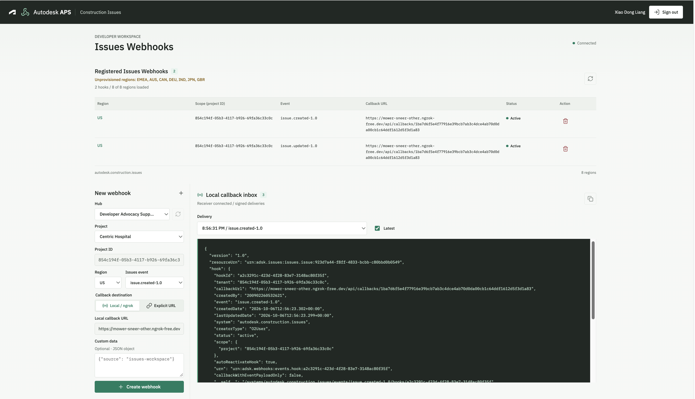

# Autodesk APS Issues Webhooks Sample


[](https://nodejs.org)
[](https://www.npmjs.com/)
[](https://expressjs.com/)
[](https://opensource.org/licenses/MIT)

Node.js/Express sample that demonstrates **Autodesk Construction Cloud Issues webhooks** with 3-legged OAuth, hub and project browsing, multi-region hook management, and a local callback JSON inbox.

Authentication and Data Management use the official `@aps_sdk/authentication` and `@aps_sdk/data-management` SDKs. Webhook list, create, and delete operations use the documented REST endpoints with Node’s built-in `fetch`.



## Usage

After the app is running locally (see [Development](#development)), open [http://localhost:3000](http://localhost:3000), choose **Sign in with Autodesk**, and approve access.

### Workspace workflow

- All hubs returned by Data Management appear in the Hub selector. Selecting a hub loads all pages of its accessible projects. Data Management warnings are surfaced rather than silently discarded.
- After sign-in, the app queries **US, EMEA, AUS, CAN, DEU, IND, JPN, GBR** for webhooks visible to the current APS app and user and follows each region’s pagination. List, create, and delete use the **signed-in user’s three-legged OAuth access token** from the browser session (refreshed server-side). This sample does **not** use a **client_credentials** (2-legged) token for webhooks. Only webhooks in hubs where the app is provisioned can be fetched.
- The webhook table is independent of Hub/Project selection and shows **region, scope (project ID), event, callback URL, status, and delete**. Hub and Project selectors only set the scope for a newly created webhook. Callback deliveries are shown independently of the selected project.
- Data Management IDs keep their `b.` prefix for SDK calls. The Issues webhook scope and read-only project field use the unprefixed project ID. Non-ACC projects remain browsable but cannot create Issues webhooks.
- Choose a hub, project, and event; pick **Local / ngrok** or **Explicit URL** for the callback; optionally add custom JSON (object under 1 KB, sent as `hookAttribute`); then click **+** to create a webhook.
- **Local** mode derives the callback URL from `NGROK_URL` and a random session-specific path. **Explicit** mode requires a public HTTPS receiver you operate. The server does not forward explicit callbacks to the local inbox.
- Successful creation is inserted into the table immediately. APS normally returns HTTP 201 with no body; the sample reads the hook ID from the `Location` header. Failures open an error dialog; duplicates typically return HTTP 409.
- Trigger a matching Issues event in the selected project. The local receiver verifies the signature, responds with HTTP 204, and stores the JSON. The browser polls its authenticated inbox every 2.5 seconds while visible. Select older deliveries or keep **Latest** checked; use the copy button for the displayed body.
- Use the trash icon in the table to delete a webhook.

Listing shows hooks visible to the current APS app and user, not every hook registered by every application or user. Creation permissions and event availability remain subject to Autodesk authorization.

### Issues events

The event menu follows the [official Issues events reference](https://aps.autodesk.com/en/docs/webhooks/v1/reference/events/issues_events/):

| Event | Status |
| --- | --- |
| `issue.created-1.0` | Available |
| `issue.updated-1.0` | Available |
| `issue.deleted-1.0` | Available |
| `issue.restored-1.0` | Available |
| `issue.unlinked-1.0` | Placement issues only |
| `comment.created-1.0` | Public Beta |
| `attachment.created-1.0` | Public Beta |
| `attachment.deleted-1.0` | Public Beta |

Beta events can change and should not be relied on for production stability. The system ID is `autodesk.construction.issues`.

### OAuth vs webhook callbacks

The OAuth callback (`/auth/callback`) and webhook callback (`/api/callbacks/<session-specific-id>`) are different endpoints. For the default setup, keep the browser on localhost; ngrok exposes the webhook receiver. Setting `NGROK_URL` enables Express `trust proxy` (required for APS callbacks through ngrok and `express-rate-limit`). If you access the entire app through ngrok, register that HTTPS OAuth callback in APS, update `APS_CALLBACK_URL`, and set `COOKIE_SECURE=true` (or `TRUST_PROXY=true` when not using `NGROK_URL`).

## Development

### Prerequisites

- [APS app credentials](https://aps.autodesk.com/myapps/) — **Traditional Web App** with Authentication, Data Management, and Webhooks APIs enabled as applicable
- Provisioned access to ACC (Forma) — an account administrator may need to add the app under **Account Admin → Custom integrations** using the same client ID
- Signed-in user with access to the relevant account and **project admin** on target projects (OAuth consent does not grant membership)
- Node.js **22 or newer** (Node **20.11+** is also compatible) and npm
- [ngrok](https://ngrok.com/) (or similar) for **local** webhook callback mode — public HTTPS tunnel to your machine
- bash-compatible terminal

### Steps to build and run the sample locally

1. Clone the repository and run `npm install`.
2. Create or copy `.env` from `.env.example`. Set `APS_CLIENT_ID` and `APS_CLIENT_SECRET`. Never commit credentials or expose them in browser code.
3. Register this OAuth callback URL on the APS app: `http://localhost:3000/auth/callback` (adjust if you change `PORT` or use ngrok for the full app).
4. Set `SESSION_SECRET` to a long random value, for example:

   ```sh
   node -e "console.log(require('node:crypto').randomBytes(32).toString('hex'))"
   ```

   When omitted in development, a random secret is generated at startup.

5. Start ngrok: `ngrok http 3000`. Put the public **HTTPS origin** (for example `https://your-domain.ngrok-free.app`) in `NGROK_URL` with no callback path. Optional if you use only explicit callback URLs.
6. Run `npm start` and open [http://localhost:3000](http://localhost:3000). Restart after changing `.env`.

If port 3000 is in use, set `PORT`, update `APS_CALLBACK_URL` and the APS app registration to match, and point ngrok at the same port.

### Commands

```sh
npm start
npm run dev
npm test
npm run check
npx playwright install chromium
npm run test:ui
```

`npm test` covers OAuth state, token refresh, project access, session isolation, callback signatures, pagination, input validation, and empty-body webhook creation. Browser tests mock APS-facing responses and exercise desktop/mobile rendering, creation, errors, and callbacks. Screenshots are written under ignored `test-results/`.

### Project layout

- `server.js` — environment configuration and local listener
- `lib/aps.js` — SDK authentication and Data Management operations
- `lib/webhooks.js` — regional listing, validation, and REST creation
- `lib/app.js` — sessions, routes, authorization, and callback verification
- `public/` — browser workspace, local fonts, and Lucide icons served from dependencies
- `test/` and `e2e/` — backend and browser checks

### Security and sample limits

- OAuth uses the APS SDK with authorization code, state validation, PKCE S256, and server-side refresh. Requested scopes: `data:read`, `data:write`, `account:read`, `user-profile:read`. Tokens and client secrets are never sent to the browser.
- Sessions use HTTP-only, SameSite=Lax cookies. Mutating app routes require a CSRF token. Token refresh is shared across concurrent requests in a session.
- Local creation includes a random per-session `token` in the webhook request. The receiver requires `x-adsk-signature` and verifies HMAC-SHA1 against the exact raw request body, per [APS signature verification](https://aps.autodesk.com/en/docs/webhooks/v1/tutorials/how-to-verify-payload-signature/). Unsigned or invalid deliveries are rejected. Explicit receivers must implement their own verification policy.
- This is a **single-process development sample**: sessions, tokens, signing secrets, and the most recent 50 callback payloads per session are in memory, with an eight-hour session lifetime. They disappear on restart, sign-out, or expiration. Payloads are capped at 256 KB; larger deliveries receive HTTP 413.
- **Webhooks persist in APS.** Old local hooks may target an expired session after sign-out or restart and return HTTP 404. Remove unused hooks via the APS API or administration tooling, or recreate local hooks after restarting or signing in again. Repeated callbacks appear as separate deliveries.
- Before production deployment, use a persistent session/token store, durable callback routing and signing secrets, queue-backed delivery processing, appropriate retention, HTTPS-only cookies, restricted proxy trust, and monitoring. Do not use ngrok and in-memory state as a production receiver.
- No APS or ngrok credentials are bundled. Automated tests use mocks and do not create real webhooks. Live authentication, account access, creation, and event delivery require verification with your APS app.

### Troubleshooting

- **Empty hubs/projects or HTTP 403** — confirm custom integration provisioning, account/project membership, and project admin rights.
- **Callbacks not arriving** — verify `NGROK_URL`, ngrok tunnel health, and that the webhook callback URL in APS matches the session path; restart and recreate hooks after sign-out or server restart if the session path changed.
- **OAuth errors through ngrok** — register the ngrok HTTPS callback on the APS app and set `APS_CALLBACK_URL` and `COOKIE_SECURE=true` when browsing via ngrok.

### Additional links

- [List system hooks](https://aps.autodesk.com/en/docs/webhooks/v1/reference/http/systems-system-hooks-GET/)
- [Create event hook](https://aps.autodesk.com/en/docs/webhooks/v1/reference/http/systems-system-events-event-hooks-POST/)
- [Issues webhook events](https://aps.autodesk.com/en/docs/webhooks/v1/reference/events/issues_events/)

## Disclaimer

This sample application was developed with AI-assisted tooling (Github Copilot) to demonstrate **Autodesk Platform Services (APS) Construction Issues webhooks**—3-legged OAuth, Data Management hub/project browsing, multi-region webhook management, and local callback handling. It is provided **as-is** for learning and demonstration only.

Reasonable care was taken to align behavior with the public APS Webhooks and Issues event documentation, but the code has **not** been validated for production use. Before relying on it in any live environment, perform your own **security review**, **error-handling and resilience checks**, and **end-to-end testing** with your APS app, ACC provisioning, and callback infrastructure. **Use at your own risk.**

## License

This sample is licensed under the [MIT License](https://opensource.org/licenses/MIT). See the `LICENSE` file in this repository.
